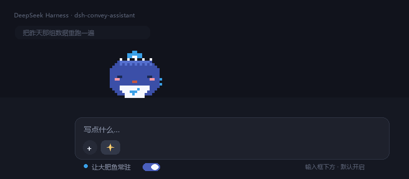
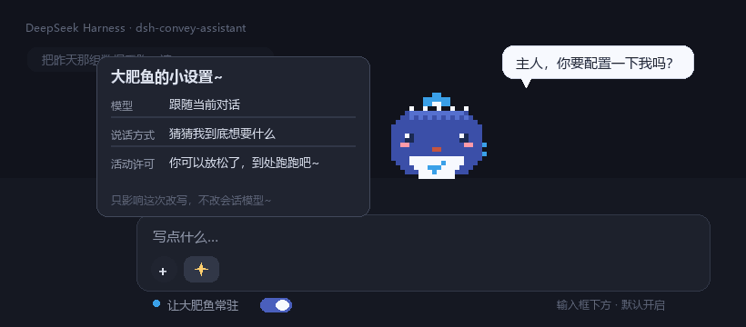

# dsh-convey-assistant

> Say it once, say it right — turn a rough draft into intent an AI agent cannot misread.

A [DeepSeek Harness](https://www.deepseek.com/en/harness/) (DSH) plugin that does three things:

**① Translates what you typed into what an agent can act on** — one ✨ turns a rough draft into a
structured, unambiguous intent (goal / deliverable / constraints / acceptance), editable in a card,
written back only after you confirm.

**② Asks you the questions you did not think to answer** — she reads the draft from the receiving
agent's seat, finds the forks that would make it guess, and turns them into one plain-language
question in the card. Add a sentence, hit Recompile, done.

**③ Keeps you company with a moving pixel fat fish** — the resident switch below the composer
(on by default): when your mouse is still she wanders around; the moment you move it she freezes.
Hover her and she asks "Master, would you like to configure me?" — click to open her settings.
**Before you press send.**



<sub>The demo animation is rendered frame by frame from the plugin's real pixel sprite — it is not a screen recording.</sub>

English | [中文](README.zh.md)

---

## The problem

People talk to AI as if it shared their head:

> "tweak that figure again, colors feel off, and rerun the fit on yesterday's data while you're at it"

Three things are undecidable for an agent: *which* figure, *which direction* the colors are off, *which file* "yesterday's data" means.
The model will not complain — it will **guess**. Then you re-explain, and that extra round trip is where the time goes.

This plugin does not guess for you:

1. It **restructures the text** into an unambiguous form;
2. It **turns whatever it genuinely cannot infer into one plain-language question**, so a one-sentence answer replaces a round trip.

## Install in 30 seconds

Three ways, pick one. The package is **prebuilt**: `lib/index.js` and `lib/client.js` are committed,
and installation runs **no build script on your machine**.

### 0. From npm (easiest, mirrored in China)

```bash
dsh plugin --profile desktop add dsh-convey-assistant
```

Or **Settings → Plugins → Add plugin**, paste `dsh-convey-assistant`, pick the npmmirror source, install.

### A. Clone + one command (recommended)

```bash
git clone https://github.com/Astra-Ursae-Majoris/dsh-plugin-conveyor-assistant.git
cd dsh-convey-assistant
node scripts/install.mjs          # installs into the desktop profile; use --profile web for another
```

The script backs up the profile's `package.json`, runs `dsh plugin add`, then enables the package in
`dsh.profile.bundles`. Want to see the plan first? `node scripts/install.mjs --dry-run`.

### B. Straight from GitHub

```bash
dsh plugin --profile desktop add github:Astra-Ursae-Majoris/dsh-plugin-conveyor-assistant
```

(Then add `dsh-convey-assistant` to `dsh.profile.bundles` in the profile's `package.json` — method A does this for you.)

### C. From the GUI

**Settings → Plugins → Add plugin**, paste `https://github.com/Astra-Ursae-Majoris/dsh-plugin-conveyor-assistant` and hit install.

If nothing shows up after a refresh, check that `dsh-convey-assistant` is listed in `dsh.profile.bundles` inside the profile's `package.json` (the GUI normally does this for you).

> Refresh the page afterwards; if nothing appears, restart DSH once (a newly added bundle sometimes needs the host to re-compose).

## Using it

1. Write your draft in the composer.
2. Click **✨** in the toolbar.
3. A card shows **your original** next to **the result**; the result is editable. If a genuine fork exists,
   the card asks a question — answer it, hit **Recompile**, and she reruns with your answer folded in.
4. Hit **Apply to draft** to replace the composer text. **You still press send yourself.**



## The resident fat fish

There is a switch below the composer: **"Let the fat fish stay around"**, **on by default**.

- While idle she slowly wanders and hops around the empty space of the conversation; **move your mouse and she freezes instantly**.
- **Hover her** and she asks: "Master, would you like to configure me?" Click it to open her settings:

| Setting | Meaning |
|---|---|
| **Model** | Defaults to "follow this conversation". You may pin one model for a single rewrite — it **does not change the model your session uses**. |
| **Posture** | "Let me finish first" (structure only) / "Guess what I really mean" (intent rewrite, default) |
| **Permission to roam** | "Go on, run around~" / "Stay still, don't move" |
| Resident switch off | She clocks out; flip it back on and she **makes an entrance** again |

She **never covers the composer or the send button** (her roaming area is computed from the composer's position),
never steals focus, and never intercepts the keyboard.

## Privacy

First priority, and checkable rather than merely promised:

| Question | Answer |
|---|---|
| Who sees my draft? | Only the model **you selected inside DSH**. The plugin owns no API key and talks to no third-party endpoint. |
| What leaves the machine? | Browser → one authenticated local route → your model. That is the entire list. |
| Does the rewrite enter my conversation? | **No.** No session event, no `sessionId`, no JSONL entry, not counted in token usage. |
| Analytics / telemetry | **None.** |
| Does my draft reach logs? | **No.** Never in error messages, console output, or `~/.dsh/logs`. |
| Does the plugin store my draft? | **No.** In memory only. |
| Is my model choice remembered? | Only the `provider/model` strings (localStorage), never any conversation content. |

**Honest boundaries:** the provider you chose obviously receives the text that is sent; an HTTPS proxy sees
connection metadata (TLS payload stays opaque); another plugin in the same host process could in principle hook
the LLM stream — that is the harness trust boundary. DSH itself already persists drafts in Electron localStorage;
this plugin adds **no** local storage of its own.

## Compatibility

- DSH `>= 0.2.2-rc.5 < 0.3.0` (developed and tested on 0.2.2-rc.5)
- Desktop and Web GUI (needs a same-origin `/api` route)
- Windows / macOS / Linux (the installer is Node; a PowerShell version is included as well)

## Uninstall

```bash
node scripts/uninstall.mjs --profile desktop
```

It removes the dependency, drops it from `dsh.profile.bundles`, deletes leftovers, and restores the pre-install
`package.json` backup.

## Development

```bash
npm install
npm run build        # lib/index.js (host) + lib/client.js (browser)
npm run typecheck    # against real DSH 0.2.2-rc.5 types
npm run verify       # pre-publish checks, including npm pack contents
npm run smoke        # runtime smoke: host imports, client only requires shared modules
```

`lib/` is a build artifact and **must be committed** — that is what makes "clone and run" true.
See [CONTRIBUTING.md](CONTRIBUTING.md) for the directory map and the hard constraints.

## License

MIT
