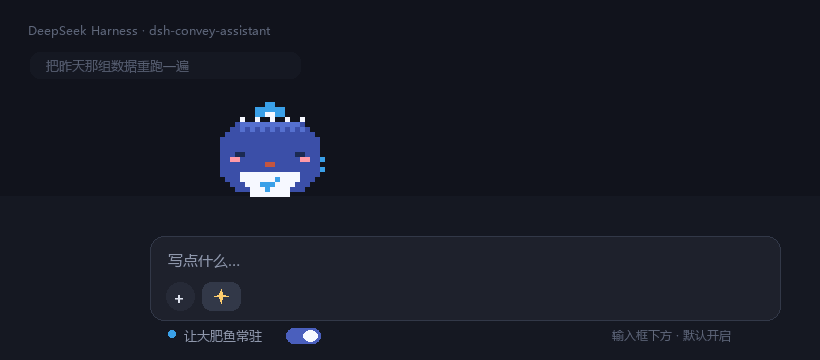
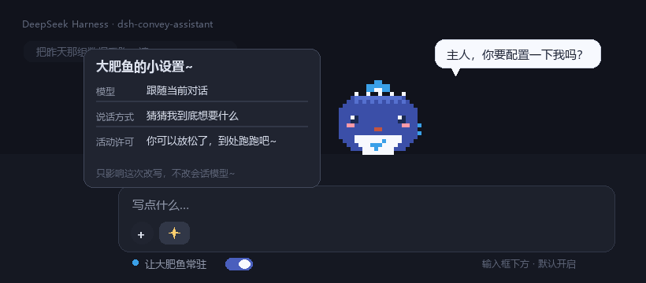

# dsh-convey-assistant

> 说一遍，就说对 —— 把口语草稿编译成 AI Agent 不会误读的意图。

一个 [DeepSeek Harness](https://www.deepseek.com/en/harness/)（DSH）插件，做三件事：

**① 把你说的话翻译成 Agent 听得懂的话** —— 点一下 ✨，口语草稿会被重写成结构化、无歧义的意图
（目标 / 交付物 / 约束 / 完成判据），你可以在卡片里直接改，确认后才写回输入框。

**② 帮你把没想清楚的地方问出来** —— 她会站在 Agent 的角度想「这句话我会不会理解错」，
把真正的分叉点变成一句人话的追问塞进卡片；你补一句、点「重新编译」，她就带着补充重跑。

**③ 用一只会动的像素大肥鱼陪着你** —— 输入框下方的常驻开关（默认开）：鼠标不动时她在对话区慢慢溜达，
鼠标一动立刻定格；悬停她会冒出气泡「主人，你要配置一下我吗？」，点开就是她的设置面板。
**在你按下发送之前**，把话说清楚。



<sub>演示动画由插件真实像素精灵与界面配色逐帧合成，不是屏幕录制。</sub>

[English](README.md) | 中文

---

## 它解决什么问题

人对 AI 说话时默认对方跟自己共享上下文：

> "那个图再改改，颜色不太对，顺便把昨天那组数据的拟合也跑一下"

这句话里有三个 Agent 无法确定的东西：「那个图」是哪张、「颜色不对」往哪边调、「昨天那组数据」是哪个文件。
模型不会报错，它会**猜**。猜错之后你得重说一遍 —— 那一轮来回就是这么来的。

这个插件不替你猜，它做两件事：

1. **把话整理成结构化、无歧义的形式**；
2. **把真正猜不出来的地方变成一句人话的追问**，你补一句就省掉一轮来回。

## 30 秒安装

三种方式任选一种。**本插件是预构建的**：仓库里已经带上 `lib/index.js` 与 `lib/client.js`，
安装时**不会**在你机器上执行任何构建脚本。

### 方式 0：从 npm 装（国内网络最省事，推荐）

包已发布到 npm，国内默认走 npmmirror 镜像，速度快：

```bash
dsh plugin --profile desktop add dsh-convey-assistant
```

或者 **设置 → 插件 → 添加插件**，输入框填 `dsh-convey-assistant`，安装源选「中国大陆镜像源」，点安装。

### 方式 A：克隆 + 一条命令

```bash
git clone https://github.com/Astra-Ursae-Majoris/dsh-plugin-conveyor-assistant.git
cd dsh-convey-assistant
node scripts/install.mjs          # 默认装 desktop profile；换 profile 用 --profile web
```

脚本会：备份 profile 的 `package.json` → 调 `dsh plugin add` 装依赖 → 把包名写进 `dsh.profile.bundles` 启用它。
先看看它会做什么：`node scripts/install.mjs --dry-run`。

### 方式 B：直接从 GitHub 装

```bash
dsh plugin --profile desktop add github:Astra-Ursae-Majoris/dsh-plugin-conveyor-assistant
```

（装完同样要手动把 `dsh-convey-assistant` 加进 profile 的 `dsh.profile.bundles`，否则 DSH 不会装配它 —— 用方式 A 就不用管这步。）

### 方式 C：GUI 里装

**设置 → 插件 → 添加插件**，粘贴仓库地址 `https://github.com/Astra-Ursae-Majoris/dsh-plugin-conveyor-assistant`，点「安装」。

如果装完刷新后毫无反应，检查 profile 的 `package.json` 里 `dsh.profile.bundles` 是否包含 `dsh-convey-assistant`（GUI 一般会自动加；没加就手动补上再刷新）。

> 装完**刷新页面**即可；按钮没出现就重启一次 DSH（新增 bundle 有时需要重新装配宿主侧）。

## 怎么用

1. 在输入框写完草稿；
2. 点工具栏的 **✨**；
3. 卡片里并排给出**原文**与**结果**，结果可以直接编辑；有歧义时卡片下方会有一句追问，
   你补一句点「重新编译」，她带着你的补充重跑；
4. 满意了点「确认写回」替换草稿 —— **发送仍然由你自己点**。



## 常驻的大肥鱼

输入框下方的开关「**让大肥鱼常驻**」，**默认开启**。

- 鼠标不动时，她在对话区的空白处慢慢游荡、偶尔跳一下；**你一移动鼠标她就立刻定格**等你操作。
- 鼠标**滑到她身上**，她会问：「主人，你要配置一下我吗？」点开是她的设置面板：

| 设置项 | 说明 |
|---|---|
| **模型** | 默认「跟随当前对话」。也可以单次指定一个模型 —— **只影响这次改写，不改变你会话用的模型**。 |
| **说话方式** | 「先听我说完」（只做结构化） / 「猜猜我到底想要什么」（读意图重写，默认） |
| **活动许可** | 「你可以放松了，到处跑跑吧~」/「呆住，不准动」 |
| 关掉常驻 | 她就下班了；再拨回来她会**重新登场** |

她永远**不会挡住输入框和发送键**（活动区按输入卡片的位置动态计算），也不抢焦点、不拦键盘。

## 隐私

这是本项目的第一优先级，而且是可以核对的：

| 问题 | 回答 |
|---|---|
| 谁会看到我的草稿 | 只有你**在 DSH 里选的模型**。插件没有自带 API key，也不连任何第三方端点。 |
| 网络出口 | 浏览器 → 本机一个受认证路由 → 你的模型。**只有这一条**。 |
| 这次改写会进会话记录吗 | **不会**。不写会话事件、不传 sessionId、不写 JSONL、不计入 token 统计。 |
| 遥测 / 埋点 | **没有**。 |
| 草稿会进日志吗 | **不会**。不进 error message、不进 console、不进 `~/.dsh/logs`。 |
| 插件自己存草稿吗 | **不存**。只在内存里。 |
| 我自己选的模型会被记住吗 | 只记 `provider/model` 两个字符串（localStorage），不含任何对话内容。 |

**诚实的边界**（不假装能消掉）：

- 你选的模型提供方当然会收到发出去的那段文本 —— 这是它工作的前提；
- 如果你配置了 HTTPS 代理，代理能看到连接元数据（TLS 载荷对它不可见）；
- 同一 Host 进程内的其它插件理论上可以 hook LLM 流 —— 这是 harness 的信任边界；
- DSH 自身本来就会把草稿明文存在 Electron localStorage 里（键 `dsh.conversation.<sessionId>`），本插件**没有新增**任何本地存储。

## 兼容性

- DSH `>= 0.2.2-rc.5 < 0.3.0`（在 0.2.2-rc.5 上开发与测试）
- 桌面端与 Web GUI 均可（需要同源的 `/api` 路由）
- Windows / macOS / Linux 都可装（安装脚本是 Node，另外附带 PowerShell 版本）

## 卸载

```bash
node scripts/uninstall.mjs --profile desktop
```

会 `dsh plugin remove` + 从 bundles 移除 + 删残留 + 恢复安装前的 `package.json` 备份，能回到装之前的状态。

## 开发

```bash
npm install
npm run build        # 产出 lib/index.js（宿主）+ lib/client.js（浏览器）
npm run typecheck    # 对 DSH 0.2.2-rc.5 的真实类型
npm run verify       # 发布前自检（含 npm pack 内容检查）
npm run smoke        # 运行时冒烟（宿主可 import、client 只 require 共享表词汇）
```

`lib/` 是构建产物且**必须提交** —— 这是"克隆即可用"的前提。目录说明与贡献指南见 [CONTRIBUTING.md](CONTRIBUTING.md)。

## 许可

MIT
